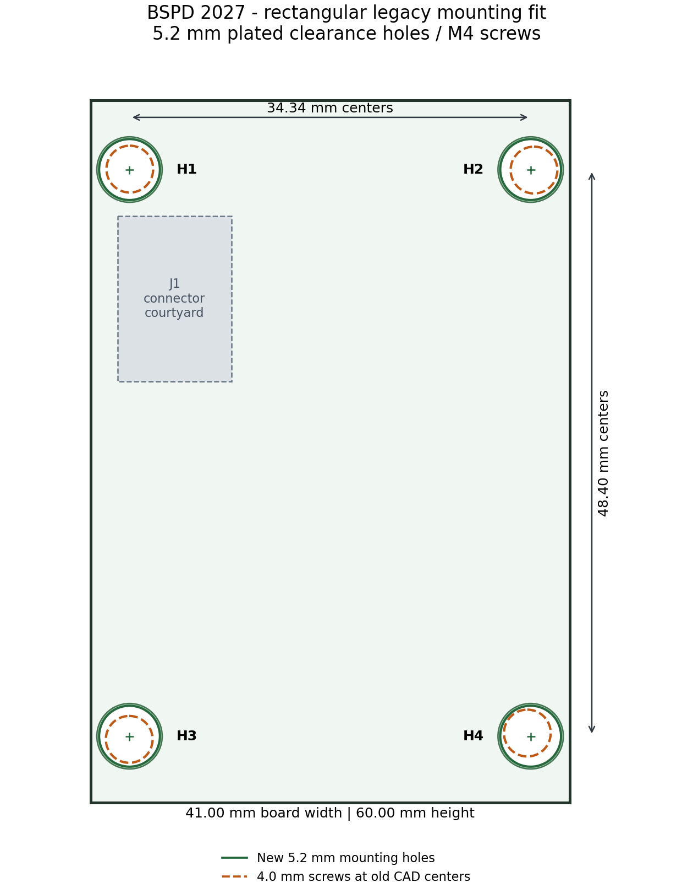

# Rectangular mounting fit to the 2024-2025 BSPD

The four hole centers form an exact, axis-aligned 34.34 x 48.40 mm rectangle. These centers are the least-squares rectangular fit to the old PCB's four irregular mounting centers. They are not a claim that the old pattern itself was rectangular.

| Hole | X (mm, KiCad coordinates) | Y (mm, KiCad coordinates) |
|---|---:|---:|
| H1, upper left | 146.925 | 55.460 |
| H2, upper right | 181.265 | 55.460 |
| H3, lower left | 146.925 | 103.860 |
| H4, lower right | 181.265 | 103.860 |

- Finished plated hole diameter: **5.20 mm**, for clearance around M4 screws at the old CAD centers.
- Ground pad diameter: **5.60 mm**, with 0.20 mm nominal annulus. Ground connections are retained.
- Approved board outline: **41.00 x 60.00 mm**, X = 143.600 to 184.600 mm, Y = 49.535 to 109.535 mm.
- Nominal outer-edge copper clearance at the mounting pads is at least 0.525 mm.
- The largest hole-center displacement from the old pattern is 0.3926 mm. A nominal 4.00 mm screw at that legacy center has 0.2074 mm remaining radial clearance inside the new hole, before manufacturing and existing-mount tolerances. Verify fit against the actual assembly before releasing a production order.
- Use compact M4 screw heads **no larger than 7.0 mm in diameter**. The top-left mounting location is close to J1; a larger washer is not accounted for and could interfere with the connector. Footprint courtyards represent a 7.0 mm head with additional clearance, rather than the previous 8.6 mm hardware envelope.

The custom footprint is included in `BSPD_Mounting.pretty` and registered by `fp-lib-table`; the four schematic footprint assignments match it. Schematic mounting-hole description fields were updated. The schematic's pre-existing mechanical symbols still have no GND pin, so the four inherited mounting-pad parity warnings remain.

No electrical component was moved, and no track or via geometry or electrical net assignment was changed. Copper zones were refilled around the moved holes and approved outline.

## Verification and existing issues

The mounting edit introduces **zero new DRC issues** compared with the received board. Schematic ERC reports zero violations. The fresh drill export confirms four 5.2 mm plated mounting holes. Independent geometry checks confirm the exact rectangle, M4 nominal fit, unchanged electrical routing, and unchanged non-mounting components.

The received layout already has **13 geometric error reports, three additional DRC warnings, two unconnected-item reports, and four mounting-pad parity warnings** after copper refill. These include routing shorts involving GND/VP, GND/VIN_DIV, GND/I_LOW, and Hard_Brake/5V. They remain open; this mounting update does not make the PCB production-ready. Four previous footprint-library mismatch warnings were resolved by supplying the custom footprint.

Baseline and edited DRC reports, original native-file backups, drill evidence, and mechanical verification are retained at:

`/Users/nick333/Documents/ChatGPT/FSAE/BSPD_mounting_rectangle_2026-11-13`

The existing Gerber ZIP, placement files, prior reports, and manufacturing manifest were not regenerated by this mounting edit and must not be treated as matching the modified PCB.

